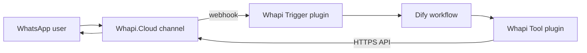

# Dify × Whapi.Cloud

Whapi.Cloud plugins for [Dify](https://dify.ai) workflows and AI agents, using the [Whapi.Cloud](https://whapi.cloud/) WhatsApp API. Connect your number by scanning a QR code in the [Whapi Panel](https://panel.whapi.cloud/) — the same linked-device pairing flow you already use for WhatsApp Web.

This monorepo ships two plugins for a full WhatsApp loop on Dify:

| Package | Role | Documentation |
|---------|------|----------------|
| [`whapi-tool/`](whapi-tool/) | **Outbound** tools: common sends/checks plus **Custom API Request** for any [documented endpoint](https://whapi.cloud/docs) | [whapi-tool/README.md](whapi-tool/README.md) |
| [`whapi-trigger/`](whapi-trigger/) | **Inbound** triggers: message and group webhook events (registers callback on your channel) | [whapi-trigger/README.md](whapi-trigger/README.md) |

**Repository:** https://github.com/Whapi-Cloud/dify-whapi

## Overview

Typical **WhatsApp auto-reply or agent** flow:

1. **Whapi Trigger** receives a webhook from your Whapi channel and starts a Dify workflow.
2. Your workflow (LLM, logic, knowledge) builds a reply.
3. **Whapi Tool** sends the response back through the Whapi API.

You can install **only** the tool plugin if you only need outbound sends from Dify. Install **both** when Dify must react to incoming messages or group events.



### Capabilities (high level)

- **Triggers:** new and updated messages; group membership and group-related events (see trigger README for payloads).
- **Actions:** send text and media; fetch a message by ID; check whether a phone number is on WhatsApp; any other Whapi API operation via **Custom API Request** (see below).

We ship **dedicated tools** for the operations most workflows need every day. The Whapi API has many more endpoints — we do not duplicate each one as a separate Dify tool. **Custom API Request** calls other documented endpoints on `gate.whapi.cloud`. **Method and path are set in the workflow** (not by the model); POST/PUT/PATCH/DELETE can change or delete channel data — see [whapi-tool/README.md#custom-api-request-safety](whapi-tool/README.md#custom-api-request-safety).

## Prerequisites

| Requirement | Tool plugin | Trigger plugin |
|---------------|---------------|----------------|
| Dify with **Plugins** enabled | Yes | Yes |
| Minimum Dify version | **1.0.0** (per `manifest.yaml`) | **1.10.0** (trigger subscriptions) |
| [Whapi.Cloud](https://whapi.cloud/) account and paired channel | Yes | Yes |
| Channel **access token** from [Whapi Panel](https://panel.whapi.cloud/) | Yes | Yes |
| API host | **`https://gate.whapi.cloud`** (default in both plugins; do not change unless Whapi support says otherwise) | Same |
| Plugin runtime | Python **3.12**, `dify-plugin` **≥ 0.9.0** | Same |

Whapi plans, sandbox limits, and billing are described on [whapi.cloud](https://whapi.cloud/) and in the [API documentation](https://whapi.cloud/docs). This integration does not change those limits.

## Install (recommended)

Build or obtain `.difypkg` files (see [Build packages](#build-packages)) and upload them in Dify:

1. **Plugins** → **Install plugin** → upload the package.
2. Install **Whapi Tool** (`whapi-0.0.1.difypkg` or current version from `whapi-tool/manifest.yaml`).
3. For inbound automation, also install **Whapi Trigger** (`whapi_trigger-0.0.1.difypkg` or current version from `whapi-trigger/manifest.yaml`).

Then follow the plugin-specific guides:

- **Tool:** credentials + tools → [whapi-tool/README.md](whapi-tool/README.md)
- **Trigger:** subscription + event families → [whapi-trigger/README.md](whapi-trigger/README.md)

On subscription save, the trigger plugin updates your channel webhook settings (`PATCH /settings`), **merging** with existing webhooks where possible.

## Development (remote debug)

For local iteration, use the [Dify Plugin CLI](https://docs.dify.ai/en/develop-plugin/getting-started/cli) (`dify` on `PATH`).

1. Open `whapi-tool/` or `whapi-trigger/`.
2. Create a virtual environment and install dependencies.
3. Copy `.env.example` → `.env` and set `REMOTE_INSTALL_URL` and `REMOTE_INSTALL_KEY` from Dify → **Plugins** → **Debug**.
4. Run `python -m main` and attach the plugin from the Dify debug UI.

**Windows (PowerShell):**

```powershell
cd whapi-tool   # or whapi-trigger
python -m venv .venv
.\.venv\Scripts\Activate.ps1
pip install -r requirements.txt
Copy-Item .env.example .env
python -m main
```

**macOS / Linux:**

```bash
cd whapi-tool   # or whapi-trigger
python3 -m venv .venv
source .venv/bin/activate
pip install -r requirements.txt
cp .env.example .env
python -m main
```

## Build packages

From the repository root, with the Plugin CLI installed:

```bash
dify plugin package ./whapi-tool
dify plugin package ./whapi-trigger
```

Outputs are `.difypkg` archives named from each plugin’s `author`, `name`, and `version` in `manifest.yaml`.

Before submitting to the [Dify Marketplace](https://docs.dify.ai/en/develop-plugin/publishing/marketplace-listing/submit-plugin-to-marketplace), validate packages with the [Dify Marketplace Toolkit](https://github.com/langgenius/dify-marketplace-toolkit) (`validate-difypkg.py`). Marketplace submissions are **one `.difypkg` per pull request** to [langgenius/dify-plugins](https://github.com/langgenius/dify-plugins); this repo intentionally publishes **two** plugins (tool vs trigger).

## Repository layout

| Path | Purpose |
|------|---------|
| `whapi-tool/` | Tool plugin: README, `PRIVACY.md`, `LICENSE` (packaged) |
| `whapi-trigger/` | Trigger plugin: README, `PRIVACY.md`, `LICENSE` (packaged) |
| `shared/whapi_client.py` | Shared HTTP client source of truth |

Each plugin ships a copy under `whapi_lib/client.py` inside its package. After editing `shared/whapi_client.py`, sync copies into both plugins before packaging.

## Privacy

Each plugin includes its own policy:

- [whapi-tool/PRIVACY.md](whapi-tool/PRIVACY.md)
- [whapi-trigger/PRIVACY.md](whapi-trigger/PRIVACY.md)

Whapi.Cloud platform policies: [Privacy](https://whapi.cloud/privacy) · [Data Processing Agreement (PDF)](https://whapi.cloud/Data-Processing-Agreement.pdf)

Traffic goes to `https://gate.whapi.cloud` (declared in each `manifest.yaml` under `network.domains`).

## Support

| Channel | Link |
|---------|------|
| GitHub Issues | https://github.com/Whapi-Cloud/dify-whapi/issues |
| Email | care@whapi.cloud |
| Whapi API docs | https://whapi.cloud/docs |

## License

[MIT](LICENSE) — see [LICENSE](LICENSE) for terms.